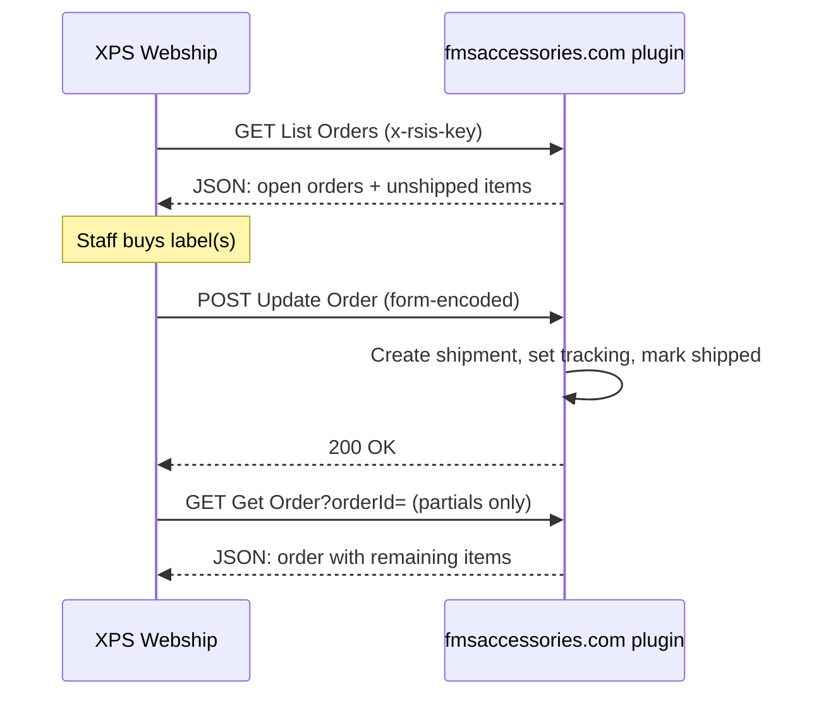
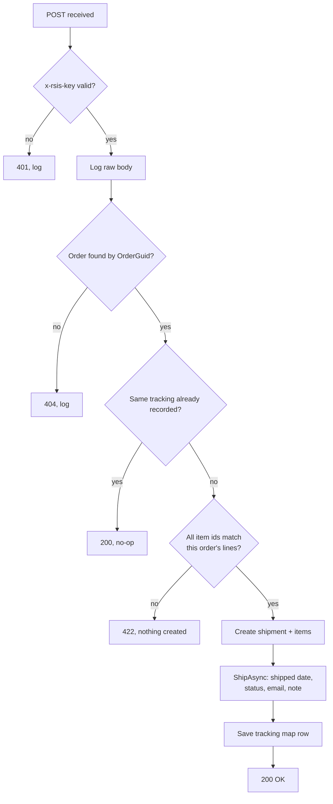

# XPS Ship Webhooks Integration: Plugin Spec

Sep 24, 2026 · @Zach

> Saved into the repo on 2026-10-13 from the original spec document, with line breaks and tables restored. The text is otherwise unchanged. Decisions and corrections made since are in [Revisions (2026-10-13)](#revisions-2026-10-13) at the end; where they conflict with the body, the revisions win.

## Goal and scope

Build a nopCommerce plugin, `Misc.XpsShip`, that lets XPS Ship pull open orders from fmsaccessories.com and post shipments back, so nobody types addresses or tracking numbers by hand again.

Today every label is made in XPS from a hand-entered order, and the tracking number is typed into the nopCommerce shipment afterward. In the last 90 days that produced 603 shipments with inconsistent tracking text ("UPS 1Z...", "UPSD b1Z...", "USP 1Z...", a USPS number labeled UPS, and three tracking numbers in one field), 52 UPS shipments with no weight, and orders marked Complete with no shipment recorded.

**In scope**

- A List Orders endpoint returning ready-to-ship orders in the XPS JSON format.
- An Update Order endpoint that creates a real nopCommerce shipment (items, quantities, tracking, carrier) through nopCommerce services.
- A Get Order endpoint so XPS partial shipments work.
- Plugin-owned log and mapping tables, a settings page, and an admin log viewer.
- Marking shipments as shipped (sets ShippedDateUtc) so shipped emails and order status update normally.

**Out of scope (later phases)**

- Delivery tracking (setting DeliveryDateUtc). XPS webhooks do not send delivery events; a later phase can poll the XPS REST Search Shipments endpoint or a carrier API.
- Live rate quotes at checkout from XPS.
- Pushing orders to XPS with the REST Put Order endpoint.
- Cleaning up historical tracking numbers.

## How XPS webhooks work

XPS polls the store; the store never calls XPS. Three URLs are entered in XPS (eCommerce Webship, gear icon, eCommerce Integrations, Add, Webhooks) along with a secret key ([overview](https://xpsshipper.com/restapi/docs/v1-ecommerce/webhooks/overview/)).



Every request carries an `x-rsis-key` header with the secret key. The plugin must reject any request without the exact key, and the URLs must be HTTPS.

| Endpoint | Method | XPS sends | Plugin returns | Docs |
| --- | --- | --- | --- | --- |
| List Orders | GET | nothing | `{"orders":[...]}` of every ready-to-ship order | [List Orders](https://xpsshipper.com/restapi/docs/v1-ecommerce/webhooks/list-orders/) |
| Update Order | POST, `application/x-www-form-urlencoded` | orderId, carrier, trackingNumbers, items\[n\]\[id\], items\[n\]\[quantity\], receiver, quote, billingInfo | 200 OK | [Update Order](https://xpsshipper.com/restapi/docs/v1-ecommerce/webhooks/update-order/) |
| Get Order | GET `?orderId=` | orderId | `{"order":{...}}` with only the items still unshipped | [Get Order](https://xpsshipper.com/restapi/docs/v1-ecommerce/webhooks/get-order/) |

Facts from the docs that shape the design:

- `carrier` is one of `ups`, `usps`, `dhl`, `fedex`.
- `trackingNumbers` is a comma-separated list (one per package on multi-box shipments).
- `items[n][id]` echoes back whatever we sent as `item.productId`, and `items[n][quantity]` can be less than ordered when staff ship a partial. So `productId` must identify the order line, not the catalog product (see Data mapping).
- `quote.charges.total` and `quote.details.quotedWeight` carry the label cost and billed weight. Worth storing for shipping-cost reporting.
- Get Order is only called when "Support Partial Shipments" is turned on in the XPS integration settings. We need it on: 72 of 506 orders shipped in the last 90 days (14%) went out in more than one shipment.
- There is no shipment ID in the POST, so idempotency has to key on orderId plus tracking numbers.

## Constraints

The plugin must survive the planned move to a clean nopCommerce install, so it touches the store only through stock interfaces.

- **Target:** nopCommerce 4.50.2, .NET 6. Plugin system name `Misc.XpsShip`, group Misc, implements `IMiscPlugin`.
- **Stock services only:** read and write through `IOrderService`, `IShipmentService`, `IOrderProcessingService`, `IProductService`, `IAddressService`, `ICountryService`, `IStateProvinceService`, `IProductAttributeFormatter`, `ISettingService`, `ILogger`. No raw SQL against core tables.
- **Never touch custom core columns.** Do not read or write `Order.IsSyncedXPS`, `Product.BinLocation`, `ProductAttributeCombination.AttBinLocation`, BackOrder\* columns, QBO\* columns, or `Customer.BMWDealer`. They will not exist after migration.
- **Plugin-owned tables** created with FluentMigrator, dropped on uninstall. Settings in a `XpsShipSettings : ISettings` class.
- **Stable keys:** identify orders by `OrderGuid` and `CustomOrderNumber`, order lines by `OrderItemGuid`, products by SKU. Never store numeric database IDs in plugin tables.
- **Shipping through the normal pipeline:** shipments must be created and marked shipped with `IOrderProcessingService.ShipAsync` so order status, shipping status, customer notifications, and order notes behave exactly as when staff ship in admin.
- **We don't have the store's C# source.** The custom `CheckoutController` and other customizations are unknown. The plugin must not depend on them, and testing must happen on a staging copy first (see Rollout).
- **Routes:** register endpoints with an `IRouteProvider` under `/xps/` so they are independent of the theme and custom controllers.

## Order selection rules

List Orders returns an order only when all of these are true. Applied to live data on 2026-09-24, the rules would send 7 regular orders to XPS and hold back 5 fully backordered orders and about 29 exchange orders.

1. `Deleted = false` and order status is Pending (10) or Processing (20).
2. Shipping status is Not yet shipped (20) or Partially shipped (25).
3. Payment is Paid (30), **or** the payment method is in the setting `ShipBeforePaymentMethods` (default: `Open Payment`). Agency PO orders sit at Pending/Pending until paid in QuickBooks but must still ship; example #8108 Arizona DPS. Unpaid card or PayPal orders never appear.
4. At least one ship-enabled order line has unshipped quantity (ordered minus already shipped).
5. The order is not on the plugin's Hold list (admin page, see Tables). An order whose special instruction contains "do not ship" (case-insensitive) is added to the Hold list automatically the first time it is seen, e.g. #8090.
6. **Exchange orders** (any line with a SKU ending in `-EXCH`) are excluded unless released on the plugin admin page. Policy says new mounts ship after the old ones arrive, except for agencies approved for ship-first. Staff click Release when that happens. Example: #8103 LA County Sheriff, 2 x FMSA-GHMT-KA3R-EXCH.
7. **Fully backordered orders** are excluded when setting `HideFullyBackorderedOrders` is on (default on). An order is fully backordered when every unshipped line is a tracked product (`ManageInventoryMethod` = track) with stock at or below 0. Examples held back today: #7611 Long Beach BMW (FMSA-GSP4-MOTORKIT x10, stock -10), #8017, #8021, #8072, #8032 (FMSA-MT-LFBH, stock 0).

Line rules inside an order:

- Only ship-enabled lines with unshipped quantity are sent, at the unshipped quantity. Gift cards and downloads never appear.
- A line whose product is tracked with stock at or below 0 is still sent, but its title starts with ` BACKORDERED:  ` so staff reduce it to 0 when shipping a partial. Example: #8108 has FMSA-MT-V2 x2 in stock and FMSA-HBKS x2 with stock -10.
- Stock of 9998, 9999, or 10000 is a placeholder for unlimited and counts as in stock.
- Attribute-tracked products (inventory method "track by attributes") use the matching `ProductAttributeCombination` stock, matched on the line's `AttributesXml`.

Orders stay in the list until every ship-enabled line is shipped, so a partial order reappears with only its remaining lines.

## Data mapping

Each order in List Orders and Get Order is built from stock nopCommerce entities. Decimals go out as strings with 2 places (4 for weight), as XPS requires. Everything sent is a prefill: staff can change the service, boxes, weights, and address in XPS before buying the label, and the plugin records what XPS actually sends back.

**Order level**

| XPS field | Source | Notes |
| --- | --- | --- |
| orderId | `Order.OrderGuid` | Stable across migration. XPS echoes it back on Update Order and Get Order. |
| orderNumber | `Order.CustomOrderNumber` | What staff see and search in XPS, e.g. `8106`. |
| orderDate | `Order.CreatedOnUtc` as Unix seconds | |
| customerNotes | `Order.CheckoutAttributeDescription`, HTML stripped, `<br />` to newline | This is where customers type the "Special Instruction" attribute: PO numbers (#8102 "PO# 36591, 1 unit for the City of Glendale") and warnings (#8090 "Do not ship"). |
| shipperReference | `CustomOrderNumber`, plus the PO if found | Regex `PO\s*#?\s*([A-Za-z0-9-]+)` on the special instruction. #8102 becomes `8102 PO 36591`. Trim to 35 characters (UPS reference limit). |
| shippingService | `Order.ShippingMethod` | Values in the last 90 days: Free (499 orders), FedEx 2Day, FedEx International Priority, FedEx Standard Overnight, FedEx Priority Overnight, FedEx International Economy. Not sent as-is. The plugin sends a service key from the Service suggestion rules below. |
| shipping\_total | `Order.OrderShippingInclTax` | |
| weightUnit | `lb` | Store base weight is pounds; convert with `IMeasureService` if the base unit ever changes. |
| sender | Plugin settings | Default: FMS Solutions, 566 Falcon Fork Way, Saint Johns, FL 32259, US, 2012648365, operations@fmsaccessories.com. |
| receiver.company / name | Shipping address Company; FirstName + LastName | |
| receiver.address1 / address2 / city / zip | Shipping address fields | |
| receiver.state | `StateProvince.Abbreviation` | e.g. `CA`, not "California". |
| receiver.country | `Country.TwoLetterIsoCode` | |
| receiver.phone | Shipping address phone, digits only | Keep last 10 digits for US numbers. |
| receiver.email | Shipping address email, else customer email | |
| packages | omitted in phase 1 | About 250 products lack dimensions, so XPS package presets are more reliable for now. |

**Service suggestion.** `shippingService` carries a prefill key, mapped once to a carrier service in XPS's service mapping. The default is UPS Ground; staff switch to USPS or anything else on the ship screen when it's cheaper. The customer's original choice goes first in `customerNotes` ("Customer selected: FedEx 2Day").

| Customer chose | shippingService sent | Map in XPS to |
| --- | --- | --- |
| Free | `FREE` | UPS Ground |
| FedEx Priority Overnight or FedEx Standard Overnight | `EXP-UPS-NEXTDAY` | UPS Next Day Air (or Next Day Air Saver) |
| FedEx 2Day | `EXP-UPS-2DAY` | UPS 2nd Day Air |
| FedEx International Priority or Economy | `INTL-UPS` | UPS Worldwide service, staff pick |

Orders with `PickupInStore = true` or no shipping address are excluded (hand deliveries and pickups stay manual).

**Item level** (one entry per ship-enabled line with unshipped quantity)

| XPS field | Source | Notes |
| --- | --- | --- |
| productId | `OrderItem.OrderItemGuid` | Not the catalog product. XPS returns this as `items[n][id]`, so the plugin knows exactly which order line shipped, even when the same SKU appears twice. |
| sku | `Product.Sku` | Null SKUs are sent as null and logged as a warning. Seen today: the printer roll spindles on #8086 and the item on #8105. |
| title | Product name + " \| " + `OrderItem.AttributeDescription` (HTML stripped, `<br />` to "; ") | #8102 becomes "ProLaser 4 Lidar Holster \| Platform: R 1200/1250 RT-P (2015-2024); LH Mount K52: Right-Handed \[FMSA-GHMT-K52R\] \[+$59.00\]". The linked mount SKU is visible to the packer. Prefix ` BACKORDERED:  ` per the line rules. |
| price | `OrderItem.UnitPriceExclTax` | Used on customs forms for international orders. |
| quantity | Ordered minus already shipped | |
| weight | `OrderItem.ItemWeight` (per unit, includes attribute weight), else current `Product.Weight` | #8102 holster: 2.91 lb with mount vs 2.25 lb bare. If both are 0, send null and log a warning. |
| imgUrl | Default product picture, 100 px, absolute URL | Optional; helps packers. |

**Weights and box sizes.** Item weights only pre-fill XPS; they never decide the label. Staff still pack, then enter each box's dimensions and weight in XPS, and those are what the carrier bills. XPS sends back only the total billed weight (`quote.details.quotedWeight`, which can be dimensional weight) and the label cost, not per-box sizes, and the plugin stores both on the shipment and the tracking map. Missing product weights therefore make the pre-fill wrong but break nothing; they matter more for FedEx rates at checkout. Per-box dimensions could be pulled later from the XPS REST shipment endpoints (phase 2).

## Update Order handling

Each Update Order POST becomes exactly one nopCommerce shipment, created and marked shipped through the normal pipeline, or nothing at all if anything is invalid.



Steps in detail:

1. **Authenticate.** Compare `x-rsis-key` to the stored key with a constant-time comparison. Missing or wrong: 401, log the attempt with IP, create nothing.
2. **Log first.** Save the raw form body to the webhook log before any processing, so every label is traceable even if processing fails.
3. **Find the order** by `orderId` (OrderGuid). Not found or deleted: 404.
4. **Clean the tracking numbers.** Split `trackingNumbers` on commas, trim spaces, uppercase, drop blanks and duplicates. Store the carrier separately (`ups`, `usps`, `fedex`, `dhl`). Never put the carrier name in the tracking field again.
5. **Idempotency.** If the tracking map already has a row for this OrderGuid with the same first tracking number, return 200 and do nothing. This covers XPS retries and staff re-sending an update.
6. **Match items.** Each `items[n][id]` must equal the `OrderItemGuid` of a line on this order. Any unknown id: 422 and create nothing. Quantity 0 lines are skipped. A quantity above the line's unshipped quantity is capped at the unshipped quantity and logged as a warning.
7. **Create the shipment** with `IShipmentService`: order, first tracking number in `TrackingNumber`, `TotalWeight` from `quote.details.quotedWeight` when the unit is lb (else the sum of item weights), and `AdminComment` = "XPS: UPS, 2 packages: 1Z..., 1Z...; label $14.82". Add one shipment item per matched line.
8. **Mark it shipped** with `IOrderProcessingService.ShipAsync(shipment, notifyCustomer: setting)`. This sets `ShippedDateUtc`, updates shipping status to Partially shipped or Shipped, adds the order note, and sends the Shipment sent email.
9. **Save the tracking map row** (see Tables) with carrier, all tracking numbers, label cost, and billed weight.
10. **Return 200.** Wrap steps 3 to 9 in a per-order lock so two simultaneous posts for one order can't double-ship lines.

**Multiple packages.** XPS sends every package's tracking number. The first, the master number of a multi-piece shipment, goes in the nopCommerce `TrackingNumber` and the shipped email. When there is more than one, the plugin also adds a customer-visible order note: "Shipped via UPS in 3 packages: 1Z..., 1Z..., 1Z...". The note is inserted with `IOrderService.InsertOrderNoteAsync` and DisplayToCustomer on, without sending the "New order note" email (Customer.NewOrderNote is active), so the customer gets one shipped email and sees all numbers on their order page. The full list is kept in the tracking map and the shipment's admin comment too. Confirm on staging that XPS lists the master number first on a real UPS multi-piece label.

**Tracking links for customers.** Today the Shipment sent email (ShipmentSent.CustomerNotification) is turned off, so customers get no shipped email, and its template shows `%Shipment.TrackingNumber%` as plain text. nopCommerce's own `%Shipment.TrackingNumberURL%` token can't fix this: it takes the link from the checkout shipping method, which has no tracker for Free (96% of orders) and gives a FedEx link for FedEx-selected orders that now ship UPS. The plugin adds its own token, `%Shipment.XpsTrackingUrl%`, through an `EntityTokensAddedEvent<Shipment>` consumer, using these URL patterns:

| Carrier | URL pattern |
| --- | --- |
| ups | `https://www.ups.com/track?tracknum={n}` |
| usps | `https://tools.usps.com/go/TrackConfirmAction?tLabels={n}` |
| fedex | `https://www.fedex.com/fedextrack/?trknbr={n}` |
| dhl | `https://www.dhl.com/us-en/home/tracking.html?tracking-id={n}` |

The token picks the carrier in this order:

1. **From XPS:** the tracking map row for this order and tracking number.
2. **From the number's format**, for shipments made outside XPS. Strip any carrier text first, since older shipments have it typed in ("UPS 1ZC602X..."). Starts with `1Z`: ups. 12 or 15 digits: fedex. Starts with 92, 93, 94, or 95 and 20 to 22 digits: usps.
3. **Otherwise** the token returns the customer's order page URL, so the link is never blank.

The plugin changes no templates. At go-live, activate ShipmentSent.CustomerNotification and replace the second cell of its Tracking Number row with:

```html
<td style="font-family: Arial,sans-serif; font-size: 13px; padding: 8px 0; border-bottom: 1px solid #f0f0f0;"><a style="color: #2e5fa3; font-weight: bold; text-decoration: none;" href="%Shipment.XpsTrackingUrl%">%Shipment.TrackingNumber%</a></td>
```

**Order completion.** Whether the order moves to Complete after the last shipment depends on nopCommerce's order status rules and the store's `OrderSettings`, which may be affected by customizations we can't see. The plugin does not set order status itself. Verify on staging which status a paid, fully shipped order ends in.

**Get Order** returns the same JSON as one List Orders entry, wrapped as `{"order":{...}}`, containing only lines with unshipped quantity. A fully shipped order returns an empty `items` array.

**Voided labels.** The XPS webhooks have no void call, so the store never hears about a void on its own. Handling it takes one extra click:

1. Void the label in XPS as usual.
2. On the plugin admin page, find the order and click Void on that label's tracking map row.
3. The plugin deletes the nopCommerce shipment the same way the admin Delete shipment button does, marks the row Voided, and adds a private order note ("XPS label 1Z... voided"). The unshipped lines reappear in List Orders, so a new label can be made from the same order.

Two caveats. The customer already got a shipped email with the voided number; the plugin sends no correction, and the replacement label sends a new email with the right number. Deleting the shipment should put shipping status back to Not yet shipped or Partially shipped, but that depends on code we can't see, so T18 checks it on staging. Phase 2 can detect voids automatically if XPS's REST shipment data shows voided status (to confirm with XPS).

## Tables, settings, and admin page

The plugin owns three tables, one settings class, and one admin page. All keys are GUIDs, order numbers, or SKUs.

**Tables** (FluentMigrator, prefix `XpsShip_`, dropped on uninstall)

| Table | Columns | Purpose |
| --- | --- | --- |
| XpsShip\_TrackingMap | Id, OrderGuid, CustomOrderNumber, PrimaryTrackingNumber (matches Shipment.TrackingNumber; OrderGuid + this is the key back to the shipment, since nopCommerce shipments have no GUID), Carrier, TrackingNumbers (comma list), PackageCount, LabelCost, BilledWeightLb, Status (Active or Voided), VoidedOnUtc, CreatedOnUtc | One row per XPS label post. Drives idempotency, tracking links, and future shipping-cost reports. |
| XpsShip\_OrderFlag | Id, OrderGuid, CustomOrderNumber, Flag (`Hold` or `ReleaseExchange`), Reason, CreatedBy, CreatedOnUtc | Hold list and exchange releases. |
| XpsShip\_WebhookLog | Id, Endpoint, HttpStatus, OrderGuid (nullable), RemoteIp, RequestBody (max 8 KB), ResponseSummary, Message, CreatedOnUtc | Every call in and out. Purged after `LogRetentionDays`. |

**Settings** (`XpsShipSettings : ISettings`)

| Setting | Default | Notes |
| --- | --- | --- |
| Enabled | false | Endpoints return 503 when off. |
| SecretKey | random 32 chars on install | Shown once, copy into XPS. Regenerate button. |
| ShipBeforePaymentMethods | `Open Payment` | Comma list of payment method system names. |
| HideFullyBackorderedOrders | true | |
| ExchangeSkuSuffix | `-EXCH` | |
| NotifyCustomerOnShip | true | Passed to ShipAsync. |
| Sender address fields | FMS address above | |
| LogRetentionDays | 90 | |
| MaxOrdersPerList | 250 | Safety cap on List Orders. |
| ServiceKeyMap | As in the Service suggestion table | Editable list of customer shipping method to service key, so new methods need no code change. |

**Admin page** (Configure button on the plugin, admin menu entry under Sales)

- Settings form with the three endpoint URLs displayed, ready to copy into XPS.
- "Preview List Orders" button: shows the exact JSON XPS would receive right now, plus the orders excluded and why (backordered, exchange, hold, unpaid).
- Hold list and exchange release: search by order number, add or remove with a reason. Labels: each order's tracking map rows with a Void button.
- Webhook log grid, filterable by order number and status, newest first.
- Warnings panel: lines sent with no SKU or no weight in the last 30 days, so the catalog gets fixed.

All admin actions require the Manage Orders permission.

## Security

List Orders exposes customer names, addresses, and phone numbers for every open order, so the endpoints are locked down as tightly as the admin.

- HTTPS only. Plain HTTP requests get 403, never a redirect that could leak the key.
- `x-rsis-key` checked on every request with a constant-time comparison. The key is at least 32 random characters and can be regenerated from the admin page.
- Optional IP allowlist setting (empty by default). Fill it in once XPS's outbound IPs are confirmed with XPS support.
- Rate limit: more than 30 failed-key requests from one IP in 10 minutes blocks that IP for an hour and writes an Error to the nopCommerce log, which the daily report's website check (C12) will pick up.
- Endpoints bypass the storefront's anti-forgery and customer session handling, run with no customer context, and write nothing except shipments, shipment items, order notes, and plugin tables.
- The webhook log stores request bodies (addresses) and is purged after 90 days. Secret keys are never logged.
- The endpoints are excluded from the site map and return `X-Robots-Tag: noindex`.

## Open decisions

Each has a default so development can start; Zach confirms or changes them before go-live.

| # | Decision | Default in this spec | Why it matters |
| --- | --- | --- | --- |
| 1 | Exchange orders in XPS | Held until released on the admin page | Policy ships new mounts after old ones arrive. Sending all ~29 open exchange orders would invite early shipments. |
| 2 | Backordered lines | Sent with `BACKORDERED:` prefix; fully backordered orders hidden | Omitting them risks staff forgetting a line when it comes in; sending them risks shipping 0-stock items by mistake. |
| 3 | Carrier choice | Decided: UPS Ground by default; FedEx selections prefill the matching UPS speed. Staff switch to USPS in XPS when cheaper. | 80% of recent shipments were UPS, 15% USPS. The reference notes still say FedEx and need updating. |
| 4 | Multi-package shipments | Decided: one shipment with the master tracking number; all numbers listed in a customer-visible order note | Alternative is one shipment per package, but XPS doesn't say which items are in which box. |
| 5 | Customer shipped emails | Decided: activate at go-live with the tracking link row | The template is off today, so customers get no shipped email. See Tracking links for the row to paste, using `%Shipment.XpsTrackingUrl%`. |
| 6 | PO on the label | Order number plus PO parsed from Special Instruction | Agencies match deliveries to POs. Needs a check that UPS labels show the reference field. |
| 7 | What XPS does with a non-200 reply | Unknown | Ask XPS support whether errors are shown to staff and whether posts are retried. Affects whether 404/422 is right or 200-with-log is safer. |
| 8 | XPS outbound IP addresses | Unknown | Needed to turn on the IP allowlist. |
| 9 | Staging site | Needed | We don't have the C# source for the custom checkout and order code, so the plugin must be tested on a copy of the live site and database first. |

## Test cases

Run these on a staging copy of the database taken on or after 2026-09-24; the live orders below will have moved on by the time development finishes. Tracking numbers in posts are test values.

| # | Scenario | Real example | Action | Expected result |
| --- | --- | --- | --- | --- |
| T1 | Simple paid order, one line | #8109 BMW Motorcycles of Ventura County, FMSA-MT-KAST x2, FedEx Standard Overnight | List Orders, then post `carrier=ups`, one tracking number, both units | Appears with `shippingService` EXP-UPS-NEXTDAY (see T20). After post: one shipment, ShippedDateUtc set, shipping status Shipped, order gone from List Orders. |
| T2 | Two lines, 17 units each | #8106 New Century BMW, FMSA-EL-CPCA x17, FMSA-MT-MCLED x17 | Post both lines in full | One shipment with 2 items, 34 units. |
| T3 | Open Payment, Pending, mixed stock, partial | #8108 Arizona DPS: MT-V2, RAM-K, MT-KRB in stock; AMF-FKA, EL-RCP, HBKS backordered | List Orders; post only the 3 in-stock lines | Order appears despite unpaid status. 3 titles start with `BACKORDERED:`. After post: Partially shipped; Get Order and List Orders show only the 3 backordered lines. |
| T4 | Fully backordered order hidden | #7611 Long Beach BMW, FMSA-GSP4-MOTORKIT x10, stock -10 | List Orders with setting on, then off | Absent when on, present when off. Preview page lists it as excluded: backordered. |
| T5 | Exchange order held, then released | #8103 LA County Sheriff, FMSA-GHMT-KA3R-EXCH x2 | List Orders; release on admin page; List Orders again | Absent, then present. |
| T6 | Holster with linked mount and PO | #8102, FMSA-GHPL4 with K52 right-hand mount; special instruction "PO# 36591" | List Orders | Title includes "\[FMSA-GHMT-K52R\]"; weight "2.9100"; shipperReference "8102 PO 36591"; customerNotes has the PO and "1 unit for the City of Glendale". |
| T7 | "Do not ship" instruction | #8090 ("This product has already been fulfilled! Do not ship") | Reopen it on staging; List Orders | Excluded and auto-added to the Hold list with that reason. |
| T8 | Line with no SKU | #8086 North Charleston PD, printer roll spindles x2 | List Orders | Line sent with `sku` null; warning logged and shown on the admin warnings panel. |
| T9 | Duplicate post | Repeat T1's post exactly | Post twice | One shipment only; second call returns 200 and logs "duplicate". |
| T10 | Three packages | Any open order; post `trackingNumbers=1zc602x70219206948, 1ZC602X70220017391,1ZC602X70224542806` | Post | TrackingNumber `1ZC602X70219206948` (uppercased, trimmed); tracking map lists all 3; customer-visible order note lists all 3. Mirrors the hand-typed entry seen in Sept 2026. |
| T11 | Wrong or missing key | Any | GET List Orders with a bad key | 401, nothing returned, attempt logged. |
| T12 | Unknown item id | #8109 | Post with a random GUID as `items[0][id]` | 422, no shipment, log explains which id. |
| T13 | Quantity over remaining | #8109 | Post quantity 5 on the x2 line | Shipment for 2 units; warning logged. |
| T14 | Unpaid card or PayPal order | Staging order placed with PayPal Standard, left Pending | List Orders | Excluded, reason "unpaid". |
| T15 | Three partial shipments over weeks | Pattern of #7899 (shipped 8/25, 8/31, 9/23) | Three posts on a 3-line order, one line each | Status Partially shipped after 1 and 2, Shipped after 3; three shipments; order leaves List Orders only after the third. |
| T16 | Tracking link token | Shipment from T1 (ups) and one posted with carrier=usps | Send "Shipment sent" email with the token in the template | Links resolve to the UPS and USPS tracking pages for those numbers. |
| T17 | Store emails and daily report | After T1 to T15 | Run the daily report queries against staging | New shipments count in items shipped by ShippedDateUtc; no order trips check C3 (Complete but not shipped) or C7 (no tracking). |
| T18 | Voided label | Shipment created in T1 (#8109) | Click Void on the plugin admin page | Shipment deleted, map row Voided, private order note added, shipping status back to Not yet shipped, order back in List Orders. A new post with a new tracking number then works normally. |
| T20 | Customer chose FedEx | #8109, FedEx Standard Overnight | List Orders | shippingService EXP-UPS-NEXTDAY; customerNotes starts with "Customer selected: FedEx Standard Overnight". |
| T21 | Tracking link for shipments made outside XPS | Existing shipments: "UPS 1ZC602X71321659005", "USPS 9334611045000004779320", "FEDEX 876435110017", "Hand Deliver" | Render the token for each | UPS, USPS, and FedEx links with the carrier text stripped; "Hand Deliver" gets the order page URL. |
| T22 | One email on multi-box orders | T10's three-package post | Check the queued emails | Exactly one Shipment sent email queued, none from New order note; the note with all 3 numbers shows on the customer's order page. |

## Rollout plan

Build and prove it on staging with the real XPS account, then switch production over in one day with the plugin able to be turned off instantly.

1. **Before coding.** Confirm the open decisions. Ask XPS support two questions: what Webship does when an Update Order call returns non-200, and which IP addresses the webhooks come from.
2. **Build on staging** with Claude Code, using this spec. Run T1 to T17.
3. **Live XPS against staging.** Add a second Webhooks integration in XPS pointing at the staging URLs with its own key. Pull orders, create real labels on 2 or 3 test orders, then void the labels in XPS. Confirm shipments, emails, and tracking links on staging.
4. **Go-live day.** Install on production with Enabled off. Use the Preview button to check the order list against the Waiting to ship section of that day's daily report. Enable, add the production integration in XPS, map the four service keys, activate the Shipment sent email with the tracking link row, and from then on make labels only from pulled orders. Orders already keyed into XPS by hand that day are shipped the old way.
5. **First two weeks.** Check the webhook log daily. The daily report should show C7 (no tracking) and C3 (Complete but not shipped) staying at zero for new orders. Rollback is one switch: disable the plugin and go back to hand entry; nothing else changes.
6. **Phase 2 candidates.** Delivery dates from the XPS Search Shipments endpoint (fills DeliveryDateUtc, which is empty on all 603 recent shipments); package dimensions once product dimensions are filled in; a monthly label-cost report from the tracking map; automatic void detection and per-box dimensions from the XPS REST API.

Also update FMS\_Reference\_Notes.md: shipping labels are mostly UPS (then USPS), not FedEx, and the XPS integration status.

## Revisions (2026-10-13)

Decided while planning the build (see `docs/superpowers/plans/2026-10-13-xps-ship.md`):

1. **nopCommerce 4.90 first.** The plugin is built for 4.90 (version 2.00) for the clean install. The 4.50.2 build (1.00, for the live store) was planned alongside it and then deferred; it will use the repo's dual-version layout when it is made. The services it relies on have the same signatures in 4.50.2. The differences are the admin menu (`IAdminMenuPlugin`), the permissions (`ManageOrders`), `EntityTokensAddedEvent<Shipment, Token>`, the absence of `ShipmentTrackingNumberSetEvent`, and `AreaNames.Admin`.
2. **Voids recompute shipping status.** The admin Delete shipment action (`OrderController.DeleteShipment`, both 4.50.2 and 4.90) reverses booked inventory, deletes the shipment and adds a note, but never recomputes `Order.ShippingStatus`. Copying it as written would leave the order at Shipped and out of List Orders, and T18 would fail. The plugin's Void sets the shipping status itself: Partially shipped if another shipped shipment remains, otherwise Not yet shipped. It then calls `CheckOrderStatusAsync`.
3. **Admin menu.** The plugin has an entry under Sales on both versions. On 4.90 it also has an entry under the shared FMS Plugins menu, like every other 4.90 plugin in this repo.
4. **Permissions.** 4.50 uses Manage Orders. 4.90 has no single Manage Orders permission; it uses Orders view to see the page and Orders create/edit/delete for saving, hold, release, void and key regeneration.
5. **Log purge** runs as a daily schedule task, which is added on install and removed on uninstall.
6. **In-process state.** The rate limit, IP blocks and per-order lock live in the web process's memory. That is correct on one web server. In a web farm, each node would count separately.
7. **Migration timestamp** `2026/10/13 09:14:27`, which is unique across this repo's plugins.

## Revisions (2026-10-21)

Versions 1.02 (4.50) and 2.02 (4.90):

1. **Order completion is now the plugin's job, behind a setting.** This replaces the "Order completion" paragraph above. nopCommerce's `CheckOrderStatusAsync` returns early on any order that isn't Paid, so agency PO orders stayed Processing after their last label and staff completed them by hand. *Complete order when fully shipped* (on by default) sets a Pending or Processing order whose shipping status is Shipped to Complete after the label posts, with a private note. `SetOrderStatusAsync` isn't public, so the plugin sets the status and then does what that method does on Complete: on 4.90 it publishes `OrderStatusChangedEvent` and stops if a handler changed the status back, sends `SendOrderCompletedCustomerNotificationAsync` (with the PDF invoice when `AttachPdfInvoiceToOrderCompletedEmail` is on) and notes the queued ids, then `SendOrderCompletedStoreOwnerNotificationAsync`. 4.50.2 has neither the event nor the store owner email, so it sends the customer email only. `IWorkflowMessageService` comes from DI, so CustomerProfile's override still adds contact copies. Payment status is left alone. Without this the email was never sent: marking the order paid later goes through `CheckOrderStatusAsync`, which returns early for Complete orders. Reward points and gift card activation on Complete are not repeated. On 4.90 the plugin also notes the store owner email's ids, which nopCommerce doesn't. A void that takes the order out of Complete deletes the unsent emails whose ids appear in "Order completed" email notes (nopCommerce's wording, so this also catches nopCommerce's own completion of a paid order). A failure is logged and doesn't fail the post. Void already moves a Complete order back to Processing.
2. **Backordered prefix is optional.** *Mark backordered lines* (on by default) controls the `BACKORDERED: ` title prefix. *Hide fully backordered orders* is unchanged.
3. **Service key by customer role.** *Service keys by customer role* holds "role = KEY" lines (role name or system name, any case). A customer with one of the roles gets that key instead of the shipping method's; the first matching line wins. `customerNotes` still names the method the customer chose.
4. **Ship-to address token.** Update Order's `receiver[...]` fields (the address XPS printed) are kept in a new nullable column `XpsShip_TrackingMap.ShipToAddress`, added by an Update migration on existing installs. `%Shipment.XpsShipToAddress%` shows it as HTML lines, falling back to the order's shipping address. With it and `%Shipment.XpsTrackingUrl%` in the nopCommerce shipped email, XPS's own notification emails can be switched off.
5. **Bins are optional (4.50 only).** *Send item bin* and *Send component part bins* (both on) control the two halves of the `[BIN …]` label. 4.90 still has no bins; reading them from `Misc.BinLocation` is a later change.
